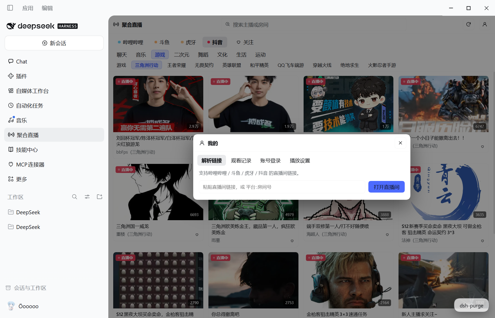
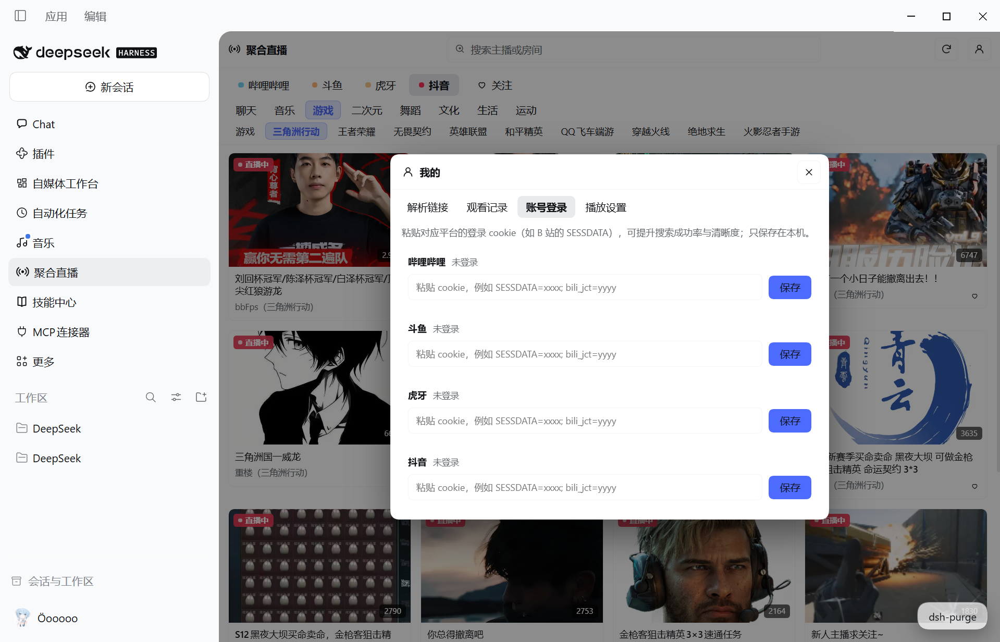

# dsh-simple-live

DSH（DeepSeek Harness）聚合直播插件：把 **哔哩哔哩 / 斗鱼 / 虎牙 / 抖音** 四个平台的直播聚合到一个左侧栏面板里，并给模型提供四个直播检索 / 播放工具。

Aggregated live-streaming panel for DeepSeek Harness — browse and play bilibili / douyu / huya / douyin live rooms from one sidebar panel, with model-facing tools.


## 功能 Features

- **四平台聚合**：顶部横向切换平台，分区 / 关注 / 搜索三种浏览方式。
- **分类浏览**：拉取各平台真实分区树，两级分类点选。
- **搜索**：按主播或房间标题搜索（抖音搜索需登录 cookie，纯数字按房间号直达）。
- **播放**：HLS 播放（内置 hls.js），多清晰度切换，线路自动探测。
- **弹幕**：哔哩哔哩 / 斗鱼真实弹幕（WSS 协议），弹幕栏可收起；虎牙 / 抖音暂不支持并明确提示。
- **我的**：
  - 解析链接：支持直播间链接、`b23.tv` / `v.douyin.com` 短链、分享文案，以及 `平台:房间号`。
  - 观看记录：本地保存最近观看（去重、上限 200）。
  - 账号登录：按平台保存 cookie（仅存本机），提升清晰度与搜索成功率。
  - 播放设置：弹幕开关 / 透明度 / 字号 / 速度、自动播放、默认清晰度。
- **关注**：收藏主播，关注页实时刷新在播状态。
- **模型工具**：`live_categories` / `live_trending` / `live_search` / `live_play`，让模型直接查分区、找房间、把房间排进面板播放。



## 安装 Install

从市场或命令行安装：

```sh
dsh plugin add github:luo173176/dsh-simple-live
```

安装后在左侧栏出现「聚合直播」入口。

## 模型工具 Tools

| 工具 | 作用 |
| --- | --- |
| `live_categories` | 列出某平台的直播分区（分组 / 子分区） |
| `live_trending` | 拉取某平台 / 分区的热门直播 |
| `live_search` | 按关键词搜索直播房间 |
| `live_play` | 在左侧栏面板里打开并播放指定房间 |

## 说明 Notes

- 数据与登录信息仅保存在本机 `~/.dsh/simple-live/`。
- 各平台接口可能随时调整；清晰度以平台实际返回为准。
- 虎牙 / 抖音弹幕暂未实现，播放器中会给出明确提示。



## 许可 License

MIT
